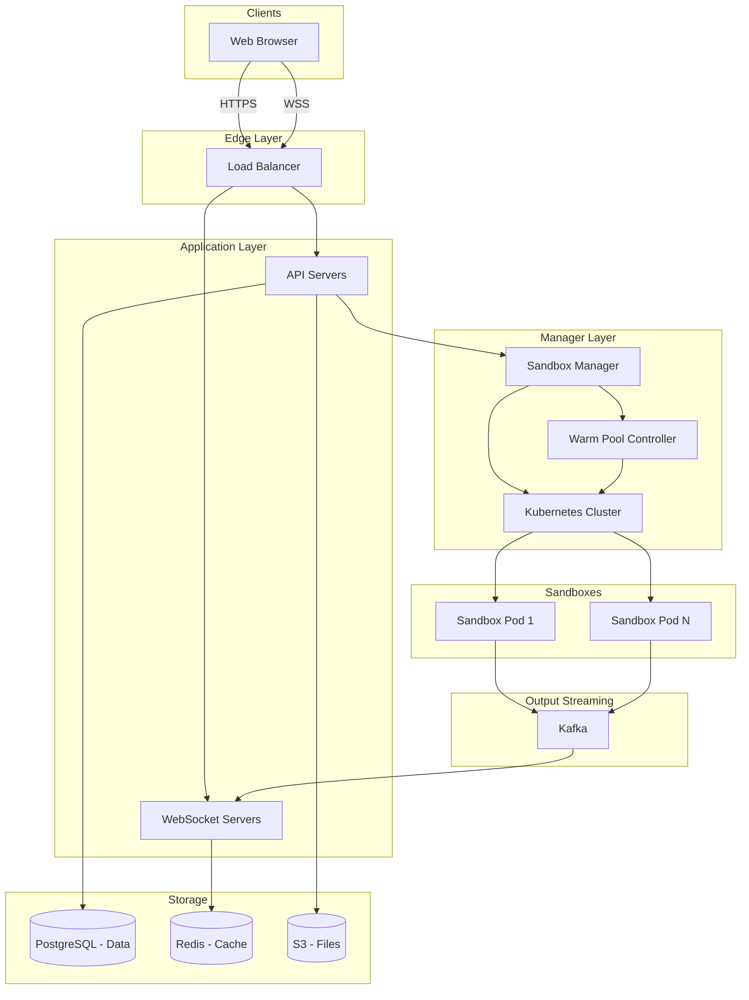

## 4. System Architecture

### High-Level Diagram




### Who Does What?

- **API Servers:** Handle login, file saving (to S3), and creating workspaces.
- **WebSocket Servers:** Send terminal text to the user. They listen to **Kafka**.
- **Sandbox Manager:** The "brain." It creates Sandboxes and assigns them to users.
- **Warm Pool Controller:** Keeps a list of "ready-to-go" Sandboxes so users don't have to wait.
- **Kubernetes:** Runs the actual Sandboxes (Pods).
- **Kafka:** A message bus that moves terminal output from the Sandbox to the WebSocket Server.

### Data Flow: Running a Command

- **User** clicks "Run".
- **API** tells **Sandbox Manager** to start the command.
- **Sandbox Manager** finds the correct **Sandbox (Pod)** and sends the command.
- **Sandbox** runs the code. Output (text) is sent to **Kafka**.
- **WebSocket Server** reads **Kafka** and sends text to the **User's** browser.

### Sandbox Design (The Pod)

Each Sandbox is a Kubernetes Pod with two containers:

- **Runtime Container:** Where the user's code runs (Python, Node, etc.). It has limited permissions.
- **Agent Container:** A helper program. It receives commands from our API and streams the output to Kafka.
**Security is key:**

- **Network Policy:** Block internet access (except for specific package managers like npm/pip).
- **Read-Only:** The root file system is read-only. We mount a separate volume for `/workspace` where the user writes code.

### Terminal Streaming (The Hard Part)

To make it feel real-time:

- **Agent** collects output from the user's code.
- It groups (batches) the text into small chunks (every 50ms).
- It sends the chunk to **Kafka**.
- **WebSocket Server** picks it up and sends it to the browser.
*Why batch?* Sending every single letter individually is too slow and expensive. 50ms is fast enough for humans but saves resources.

**Code Logic for Agent:**

```python
class OutputStreamer:
    def capture(self, data):
        self.buffer.append(data)

        # Send to Kafka if buffer is big OR 50ms has passed
        if self.should_flush():
            self.send_to_kafka(self.buffer)
            self.buffer = []
```


### Reconnecting

If a user refreshes the page, they shouldn't lose the terminal history.

- **Solution:** Store the last 1 hour of output in **Redis**.
- When a user reconnects, send the old data from Redis first, then switch to live Kafka streaming.

### Warm Pool Strategy (Speeding up Start Times)

Starting a new container takes 10-30 seconds. This is too slow.
**Solution:** Start them *before* the user needs them.

- **Warm Pool:** Keep 500 "blank" Python environments running.
- **Allocation:** When a user clicks "Start", grab one from the pool. It takes 1 second.
- **Refill:** The Pool Controller sees the pool is low and starts more.

---

来源：[DrustZ / Mingrui Zhang · online_resource/1p3a-openai.md](https://github.com/DrustZ/ai_interview_prep_2026/blob/04316c111d0e4b75ca2ab8de0e6b42379727946e/online_resource/1p3a-openai.md)。作者整理资料；许可和第三方来源范围见阅读指南。
