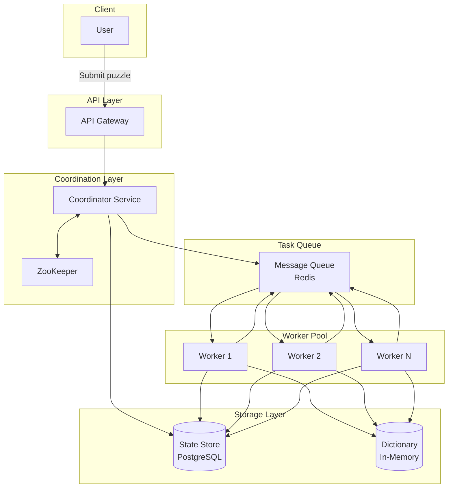
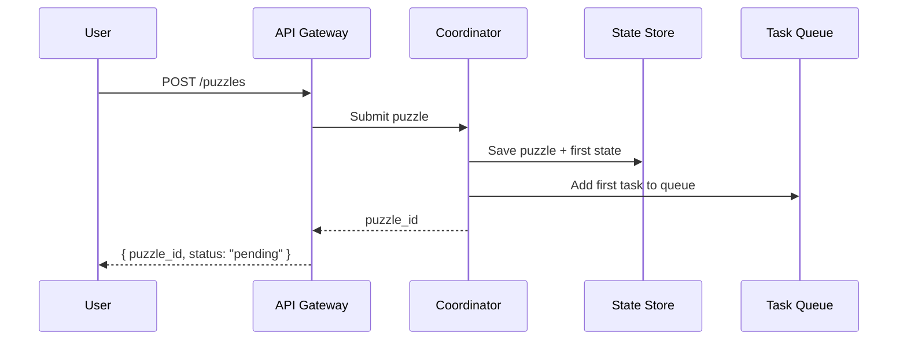
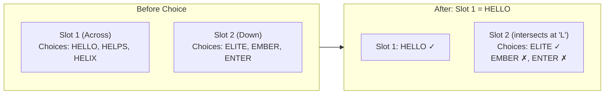
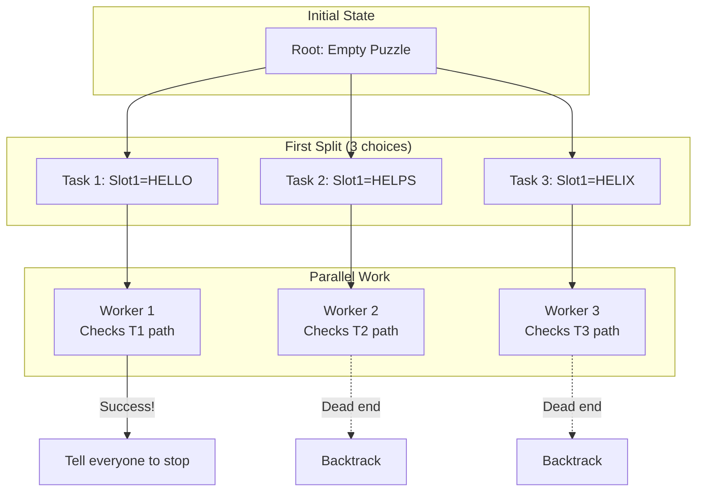

## Step 4: System Architecture

### System Diagram




### How It Works

**1. Submitting a Puzzle**




**2. Worker Processing Loop**

Each worker runs a loop like this:

```python
while true:
    task = queue.dequeue()
    state = load_state(task.state_id)

    if is_solved(state):
        mark_puzzle_solved(state)
        return

    if is_dead_end(state):
        mark_task_dead_end(task)
        continue

    # Pick the best slot to fill next
    slot = pick_most_constrained_slot(state)
    candidates = get_valid_words(slot, state)

    if len(candidates) == 0:
        mark_task_dead_end(task)
        continue

    if len(candidates) > SPLIT_THRESHOLD:
        # Too many choices - split this into smaller tasks
        for word in candidates:
            new_state = apply_assignment(state, slot, word)
            save_state(new_state)
            queue.enqueue(new_task(new_state))
    else:
        # Few choices - check them one by one
        for word in candidates:
            new_state = apply_assignment(state, slot, word)
            if explore_dfs(new_state):
                return  # We found the answer!
```


**Key Idea:** This is Distributed DFS. If a worker sees too many options, it splits the work and puts it in the queue for others. If there are only a few options, it does the work itself to save time.

**3. Spreading Constraints**

When you put a word in a slot, it limits what words can go in the crossing slots.




This is important because it removes bad choices early.

### The Main Logic: Distributed DFS

**Why DFS (Depth First Search)?**

| Approach | Memory | Parallelism | Speed |
| --- | --- | --- | --- |
| BFS | Huge (bad) | High | Finds shortest path |
| DFS | Low (good) | Lower | Finds *any* answer fast |

For crosswords, we just want *any* valid answer, and we don't want to run out of memory. DFS is better for this.

**Distributed DFS Strategy**




**Key mechanisms:**

- **Task splitting** — If a state has many choices, make new tasks.
- **Queue** — Idle workers grab tasks from here.
- **Stopping early** — If someone wins, tell everyone to stop.
- **Dead ends** — If no words fit, stop and go back.

---

来源：[DrustZ / Mingrui Zhang · online_resource/1p3a-openai.md](https://github.com/DrustZ/ai_interview_prep_2026/blob/04316c111d0e4b75ca2ab8de0e6b42379727946e/online_resource/1p3a-openai.md)。作者整理资料；许可和第三方来源范围见阅读指南。
