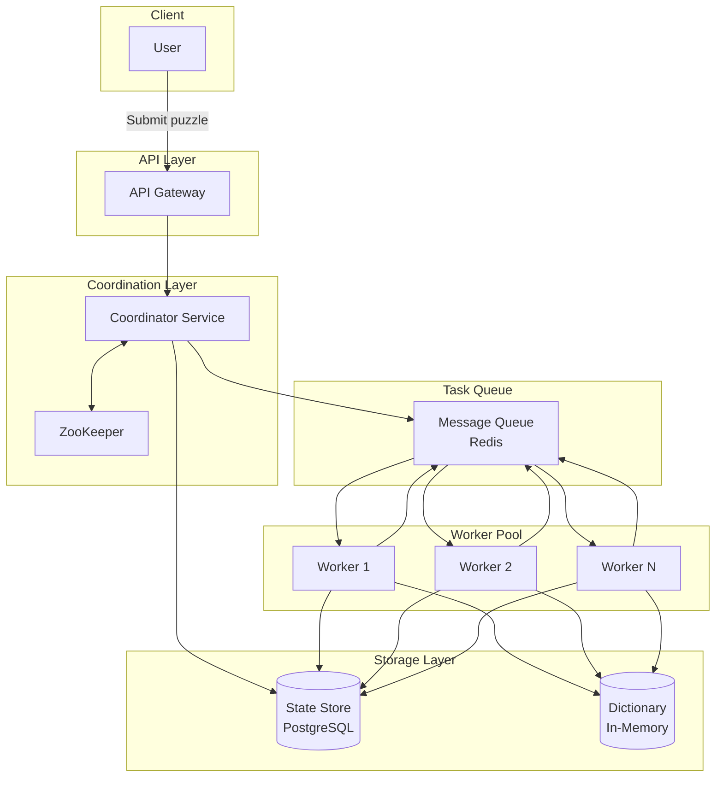
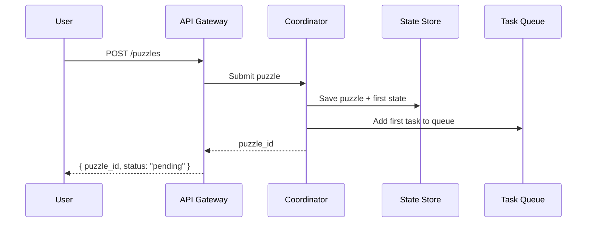
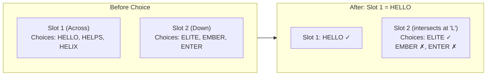
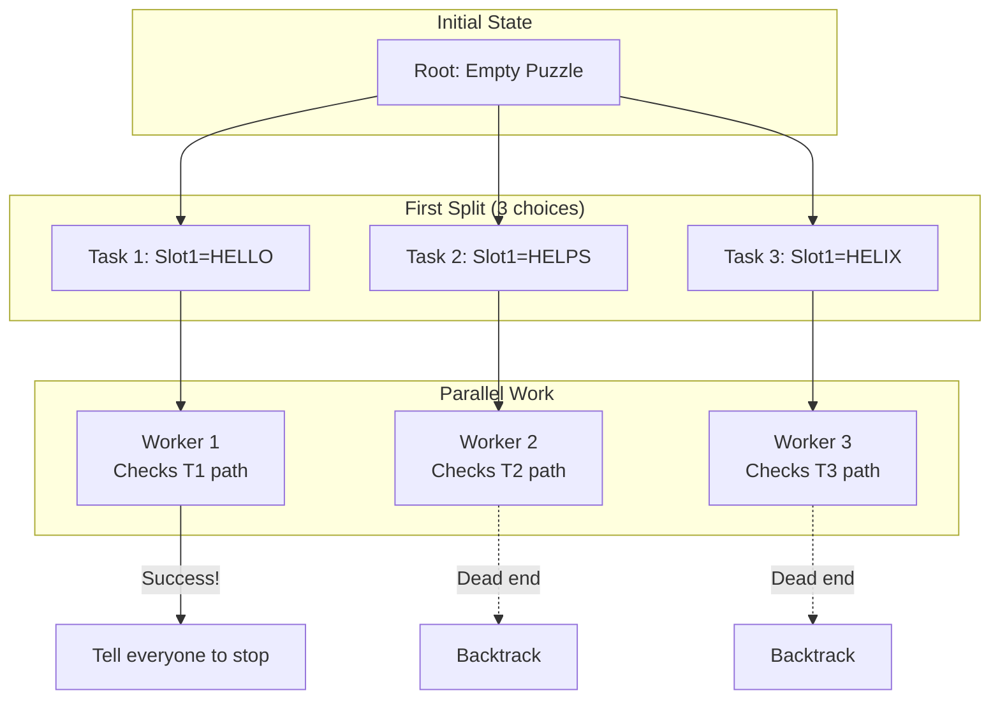

> DrustZ 整理的复习指南。公司与轮次信息沿用作者的来源记录。

## Design a Crossword Puzzle Solver

### Design a Crossword Puzzle Solver

Design a service that solves crossword puzzles. You are given a board with empty spots (positions, directions, lengths) and a dictionary of about 1 million words. You must find words that fit into the slots and match correctly where they cross each other.

The board is medium-sized (~50x50) with about 100 slots to fill. **Important:** The interviewer does not want a clever math algorithm. They want you to see that one computer is too slow to solve this (it would take forever). You must design a **distributed system** to split the work across many computers (workers).

**Common mistake:** Do not spend all your time trying to write the perfect algorithm. The key is to prove one computer will fail, and then design a system that shares the work, handles dead ends fast, and moves tasks around if workers get stuck.

## What Candidates Experienced

### Experience #1: The Guess-and-Check Method

The board size wasn't clear at first, but the interviewer confirmed it was about 50x50 with 100 slots. The goal was to find *any* valid answer.

The candidate proved that checking every combination on one machine is impossible. They proposed a **stochastic optimization** approach (like a sophisticated guessing game). They spent the whole interview explaining how the system flows. The interviewer said: "I haven't seen this approach before, but I need to check if it works."

The 'standard' answer is Distributed DFS (Depth First Search). However, many people use simulation methods—splitting tasks and trying again if they get stuck.

### Experience #2: Getting Stuck on the Algorithm

This candidate treated the question like a coding puzzle. They spent too much time looking for the "perfect" algorithm. Halfway through, they realized it was a system design problem, not a coding problem.

They tried to fix it by using a standard system design template, but it was the wrong fit.

This is really a **job scheduler problem**. Because the board is big, one machine cannot finish in time. You need to split the puzzle into pieces for many workers, stop bad paths quickly, and move work around if some tasks are too hard.

## How to Solve It

A crossword solver is a service. It takes a board with empty slots and a list of words. It finds which words go where. The hard part is doing this quickly when checking every option on one computer is too slow.

## Step 1: What We Need

### Basic Features

- **Solve puzzles** — Take a board and a dictionary, then find a valid set of words.
- **Handle rules** — Words must fit the length of the slot and share letters where they cross.
- **Return solution** — Show the user the completed puzzle.

### What We Don't Need

- Making new puzzles from scratch.
- Understanding clues (we ignore the meaning of clues).
- Finding every possible answer (finding one is enough).
- User interface (UI) for editing.

### System Goals

| Requirement | Target | Notes |
| --- | --- | --- |
| Board size | ~50×50 | Medium-sized puzzle |
| Word slots | ~100 slots | Each needs a word from the list |
| Dictionary | ~1 million words | Standard English dictionary |
| Latency | Minutes acceptable | This is a slow job, not instant |
| Reliability | Must find solution | If an answer exists, we must find it |

The interviewer will likely say the board is 50×50. This is big enough to ensure that a simple brute-force approach on one computer will fail. This forces you to design a distributed system.

### Why One Computer Fails

**The Math:**

- 100 slots to fill.
- About 1,000 words fit each slot length.
- Total combinations: $1000^{100} = 10^{300}$.
- Even with shortcuts, this is too big for one machine.
**The Insight:** Logic cuts down the list of choices, but you still need many computers working together to search through the remaining options.

**Common mistake:** Do not waste time optimizing the code for one computer. Prove it won't work, then start designing the distributed system.

## Step 2: Data Structures

### Main Objects

```text
Puzzle
├── id: UUID
├── width: integer
├── height: integer
├── slots: Slot[]
└── status: "pending" | "solving" | "solved" | "failed"

Slot
├── id: integer
├── start_row: integer
├── start_col: integer
├── direction: "across" | "down"
├── length: integer
├── clue: string | null               // Metadata, we ignore this
└── assigned_word: string | null

Dictionary
├── words: string[]
└── by_length: Map<integer, string[]>  // Grouped by word length

SearchState
├── id: UUID
├── puzzle_id: UUID
├── assignments: Map<slot_id, word>    // Current progress
├── remaining_slots: slot_id[]         // Empty slots
├── depth: integer                     // How deep we are in the tree
└── parent_state_id: UUID | null       // To go back if stuck

Task
├── id: UUID
├── puzzle_id: UUID
├── state_id: UUID
├── priority: integer
├── status: "pending" | "running" | "completed" | "dead_end"
└── assigned_worker: string | null
```


### Why We Designed It This Way

**Why track SearchState separately?**

- It lets us give work to different computers. Each state is a starting point for a worker.
- If a worker crashes, we can pick up where it left off.
- It lets us split big tasks into smaller ones.
**Why index the dictionary by length?**

- Slots have specific lengths. We only care about words that match that length.
- This shrinks the list of choices from 1 million to about 1,000–10,000 per slot.

## Step 3: Interface Design

This system processes jobs in batches. It is not real-time. We need ways to submit a job and check if it is done.

### REST Endpoints

```text
POST /puzzles
  Request:  {
    "width": 50,
    "height": 50,
    "slots": [
      { "start_row": 0, "start_col": 0, "direction": "across", "length": 5, "clue": "A greeting" },
      ...
    ],
    "dictionary_id": "en-1m" // Use the big dictionary
  }
  Response: { "puzzle_id": "abc123", "status": "pending" }

GET /puzzles/{puzzle_id}
  Response: {
    "puzzle_id": "abc123",
    "status": "solving",
    "progress": { "explored_states": 150000, "active_workers": 8 }
  }

GET /puzzles/{puzzle_id}/solution
  Response: {
    "puzzle_id": "abc123",
    "status": "solved",
    "solution": [
      { "slot_id": 1, "word": "HELLO", "direction": "across", "position": "1-Across" },
      ...
    ]
  }
```


## Step 4: System Architecture

### System Diagram




### How It Works

**1. Submitting a Puzzle**




**2. Worker Processing Loop**

Each worker runs a loop like this:

```python
while true:
    task = queue.dequeue()
    state = load_state(task.state_id)

    if is_solved(state):
        mark_puzzle_solved(state)
        return

    if is_dead_end(state):
        mark_task_dead_end(task)
        continue

    # Pick the best slot to fill next
    slot = pick_most_constrained_slot(state)
    candidates = get_valid_words(slot, state)

    if len(candidates) == 0:
        mark_task_dead_end(task)
        continue

    if len(candidates) > SPLIT_THRESHOLD:
        # Too many choices - split this into smaller tasks
        for word in candidates:
            new_state = apply_assignment(state, slot, word)
            save_state(new_state)
            queue.enqueue(new_task(new_state))
    else:
        # Few choices - check them one by one
        for word in candidates:
            new_state = apply_assignment(state, slot, word)
            if explore_dfs(new_state):
                return  # We found the answer!
```


**Key Idea:** This is Distributed DFS. If a worker sees too many options, it splits the work and puts it in the queue for others. If there are only a few options, it does the work itself to save time.

**3. Spreading Constraints**

When you put a word in a slot, it limits what words can go in the crossing slots.




This is important because it removes bad choices early.

### The Main Logic: Distributed DFS

**Why DFS (Depth First Search)?**

| Approach | Memory | Parallelism | Speed |
| --- | --- | --- | --- |
| BFS | Huge (bad) | High | Finds shortest path |
| DFS | Low (good) | Lower | Finds *any* answer fast |

For crosswords, we just want *any* valid answer, and we don't want to run out of memory. DFS is better for this.

**Distributed DFS Strategy**




**Key mechanisms:**

- **Task splitting** — If a state has many choices, make new tasks.
- **Queue** — Idle workers grab tasks from here.
- **Stopping early** — If someone wins, tell everyone to stop.
- **Dead ends** — If no words fit, stop and go back.

## Step 5: Hard Problems & Solutions

### Topic 1: Choosing Which Slot to Fill First

**Problem:** If we pick slots randomly, we might waste time.

**Solution:** Fill the hardest slot first. This is the slot with the *fewest* possible words. This is called the "Most Constrained Variable" (MCV) heuristic.

```text
function pick_most_constrained_slot(state):
    min_candidates = infinity
    best_slot = null

    for slot in state.remaining_slots:
        candidates = count_valid_words(slot, state)
        if candidates < min_candidates:
            min_candidates = candidates
            best_slot = slot

    return best_slot
```


**Why this works:**

- It tackles bottlenecks immediately.
- It finds dead ends quickly, so we don't waste time on bad paths.

### Topic 2: Splitting Work Smartly

**Problem:** Some tasks take forever, others finish instantly. If we don't balance this, some workers will sit idle.

**Solution:** Only split tasks if the list of candidates is long.

```text
SPLIT_THRESHOLD = 10  # Adjustable number

function should_split(candidates, depth):
    # Split if many choices AND we aren't too deep
    return len(candidates) > SPLIT_THRESHOLD and depth < MAX_SPLIT_DEPTH
```


**Adaptive splitting:**

- If workers are idle → Split more often (lower the threshold).
- If the queue is full → Split less often (raise the threshold).

### Topic 3: Finding Dead Ends Fast

**Problem:** Many paths lead nowhere. How do we stop exploring them early?

**Solution:** Look ahead. Before picking a word, check if it makes any crossing slot impossible to fill.

```text
function is_consistent(state, slot, word):
    # Try the word
    new_state = apply_assignment(state, slot, word)

    # Check intersecting slots
    for intersecting_slot in get_intersections(slot):
        if count_valid_words(intersecting_slot, new_state) == 0:
            return false  # This is a dead end

    return true
```


This saves time by pruning bad branches before we even explore them.

### Topic 4: The Random Guessing Method

**Alternative:** You can use a random method (stochastic optimization) first. If it fails, use the precise DFS method.

Some candidates suggest "Simulated Annealing."

```text
function solve_stochastic(puzzle):
    # Start with random words
    state = random_assignment(puzzle)

    temperature = INITIAL_TEMP
    while temperature > MIN_TEMP:
        # Pick a slot and try a new word
        slot = random_slot(state)
        new_word = random_valid_word(slot)

        # Check errors
        old_violations = count_violations(state)
        new_state = swap_word(state, slot, new_word)
        new_violations = count_violations(new_state)

        # Keep if better, sometimes keep if worse (to escape traps)
        if new_violations < old_violations:
            state = new_state
        elif random() < exp((old_violations - new_violations) / temperature):
            state = new_state

        temperature *= COOLING_RATE

    return state if count_violations(state) == 0 else null
```


**Trade-offs:**

- It can be faster.
- It is not guaranteed to find an answer.
- Easy to run on many machines at once.

### Topic 5: Stopping When Done

**Problem:** Worker 1 finds the answer. How do Worker 2 and 3 know to stop?

**Solution:** The Coordinator sends a "Cancel" message.

```text
Coordinator:
    on solution_found(puzzle_id, solution):
        store_solution(puzzle_id, solution)
        increment_generation(puzzle_id)
        broadcast("cancel", puzzle_id, generation)

Worker:
    before processing task:
        if task.generation < current_generation(puzzle_id):
            skip task  # This is old work

    periodically:
        check for cancellation messages
        if cancelled:
            stop working
```


### Topic 6: Handling Crashes

**Worker failure:**

- The Coordinator checks if workers are alive (heartbeats).
- If a worker dies, the Coordinator puts its task back in the queue.
- We save state in a database, so no progress is lost.
**Coordinator failure:**

- ZooKeeper picks a new leader.
- The new leader reads the state from the database.
- Workers reconnect automatically.

### Topic 7: Knowing When to Give Up

**Problem:** What if the puzzle has no solution?

**Solution:** Count the tasks. If all tasks end in dead ends and the queue is empty, there is no solution.

```text
Coordinator tracks:
├── total_tasks_created: counter
├── tasks_completed: counter (dead ends + solution found)
└── active_tasks: set

When tasks_completed == total_tasks_created AND active_tasks is empty:
    if no solution found:
        mark puzzle as "unsolvable"
```


**Key insight:** Distributed DFS explores everything. If every path is a dead end, we have proven no answer exists.

## What to Remember

Before you finish the interview, make sure you:

- [ ] Proved that one computer cannot solve it ( $10^300$  options).
- [ ] Explained Distributed DFS.
- [ ] Explained how filling one slot limits the choices for others.
- [ ] Discussed picking the hardest slot first (MCV).
- [ ] Covered how to split tasks and balance the load.
- [ ] Explained how to spot dead ends.
- [ ] Explained how to stop everyone when the answer is found.
- [ ] Mentioned what happens if a worker crashes.
- [ ] Discussed how to know if a puzzle is impossible.

## Recap

| Component | Technology | Purpose |
| --- | --- | --- |
| Task distribution | Message Queue (Redis) | Send work to workers |
| State storage | PostgreSQL | Save progress in case of crashes |
| Coordination | ZooKeeper | Manage workers and leaders |
| Dictionary | In-memory | Fast lookups by word length |
| Search algorithm | Distributed DFS | Many computers searching together |
| Optimization | MCV heuristic + Forward checking | Reduce the number of options fast |

**Key takeaway:** This problem is about recognizing when a simple loop is too slow. You need to design a system that takes a sequential process (DFS) and splits it across many machines, while handling failures and keeping everyone busy.

*原帖: [来源链接](https://www.1point3acres.com/interview/thread/7100131*)

---

### 来源与内容类型

- Content kind: `locally-saved-topic-editorial`
- [原始来源](https://www.1point3acres.com/interview/problems/company/openai/crossword-puzzle-solver)
- [相关来源](https://www.1point3acres.com/bbs/thread-1174549-1-1.html)

代码说明：无法独立解析的片段按 text 保留原文；完整代码文件可通过来源或下载包查看。


---

来源：[DrustZ / Mingrui Zhang · 1acre3points_crawl/data/questions.json](https://github.com/DrustZ/ai_interview_prep_2026/blob/04316c111d0e4b75ca2ab8de0e6b42379727946e/1acre3points_crawl/data/questions.json)。作者整理资料；许可和第三方来源范围见阅读指南。
