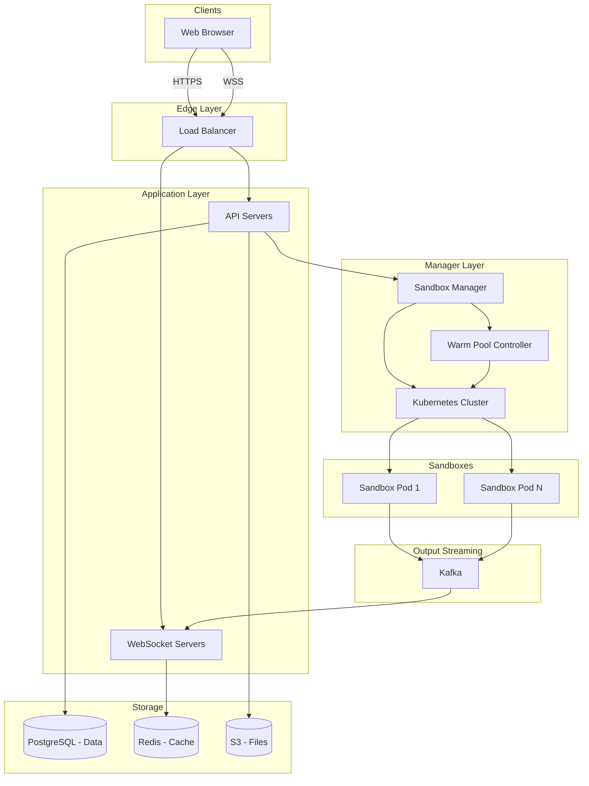

> DrustZ 整理的复习指南。公司与轮次信息沿用作者的来源记录。

## Design a Cloud IDE

### Design a Cloud IDE

**Problem:** Design a cloud-based IDE like Replit or GitHub Codespaces.
**Goal:** Users can write code, manage files, and run terminal commands in their browser. They should not need to install anything on their own computer.

This problem tests your ability to design systems that handle:

- **Resource Management** (Managing CPU/RAM for thousands of users).
- **Real-time Streaming** (Showing terminal output instantly).
- **Isolation** (Making sure User A cannot see User B's files).
The hardest parts are managing the lifecycle of the Virtual Machines (VMs) and sending terminal text to the browser quickly.

## 1. What We Need to Build

### Functional Requirements

- **File Management:** Users can create folders, and add, edit, or delete files.
- **Run Code:** Users can run commands and see the output (stdout/stderr) instantly.
- **Stop Processes:** Users can stop a program that is running.
- **Install Packages:** Users can install libraries (like `npm install`) and they stay there while the session is active.
- **Sharing:** Users can share their workspace so others can view or edit it.
*Note on Sharing:* We will focus on simple access control. We will not cover real-time collaborative typing (like Google Docs) in this guide.

*Note on Persistence:* When a user installs a package, it stays until they close the tab/session. Saving the whole operating system state forever is hard and usually a paid feature.

### System Requirements (Non-Functional)

| Requirement | Target | Reason |
| :--- | :--- | :--- |
| **Startup Speed** | < 5 seconds | Users hate waiting for the environment to load. |
| **Output Speed** | < 100ms | Typing in the terminal needs to feel instant. |
| **Reliability** | 99.9% | Important for paying customers. |
| **Scale** | 100K users at once | Must handle popular traffic. |
| **Security** | Strong Isolation | One user must never access another user's data. |

*Interview Tip:* Ask the interviewer: "Do we support jobs that run for hours, or just short coding sessions?" For this design, we assume interactive coding with a 12-hour limit.

### Capacity Estimation

**Assumptions:**

- 100,000 concurrent users.
- Each user gets: 2 vCPU, 4GB RAM.
**Compute Needed:**

- 100,000 users × 2 vCPUs = **200,000 vCPUs**.
- 100,000 users × 4GB RAM = **400TB RAM**.
- If one server has ~40GB RAM, we need about **10,000 servers**.
**Network Bandwidth (Terminal Text):**

- Assume 50% of users are running a command at the same time.
- 50,000 active processes × 1KB/second = **50MB/second**.
- A small **Kafka** cluster (3-5 brokers) can easily handle this.
**Conclusion:** The biggest cost is the servers (compute), not the storage or network. We must be smart about how we use the VMs to save money.

## 2. Database Schema

### Core Entities

```text
Workspace
├── id: UUID
├── owner_id: UUID
├── name: string
├── template: string (e.g., "python", "node")
├── sharing_mode: enum (private, view, edit)
└── timestamps...

File
├── id: UUID
├── workspace_id: UUID (Foreign Key)
├── path: string (e.g., "/src/main.py")
├── content: text (for small files)
├── content_ref: string (link to S3 for large files)
└── is_directory: boolean

Process
├── id: UUID
├── workspace_id: UUID (Foreign Key)
├── sandbox_id: UUID (Foreign Key)
├── command: string (e.g., "npm run dev")
├── status: enum (running, completed, failed)
├── exit_code: integer
└── timestamps...

Sandbox (The Virtual Computer/Container)
├── id: UUID
├── workspace_id: UUID (Foreign Key)
├── user_id: UUID
├── status: enum (provisioning, warm, assigned, running, idle)
├── instance_type: string (cpu-small, gpu)
├── ip_address: string
└── expires_at: timestamp
```


### Relationships

- A **User** has many **Workspaces**.
- A **Workspace** has many **Files**.
- A **Workspace** has exactly one active **Sandbox** (the running environment).
- A **Sandbox** can run many **Processes** (commands).
*Note:* We keep `Sandbox` and `Process` separate. The Sandbox is the computer; the Process is a specific command running on that computer.

## 3. How Clients Talk to Servers (API)

### Protocol Strategy

| Action | Protocol | Why? |
| :--- | :--- | :--- |
| **Manage Files/Settings** | REST | Simple and standard. |
| **Terminal Output** | WebSocket | Needs to be real-time (two-way). |
| **File Uploads** | REST + multipart | Better for large data. |

### REST Endpoints

```text
# Workspace Basics
POST   /api/workspaces                   # Create new
GET    /api/workspaces/{id}              # Get details
DELETE /api/workspaces/{id}              # Delete

# Files
GET    /api/workspaces/{id}/files        # List all files
GET    /api/files/{id}                   # Read file content
POST   /api/workspaces/{id}/files        # Create file
PUT    /api/files/{id}                   # Save file content

# Running Code
POST   /api/workspaces/{id}/run          # Run a command
# Returns: { "process_id": "...", "stream_token": "..." }

POST   /api/processes/{id}/cancel        # Stop a command
```


### WebSocket Protocol

We use WebSockets to stream the terminal text. The client gets a `stream_token` from the REST API first.

**Connect:**
`WSS /api/stream/{sandbox_id}?token=stream_token`

**Server sends to Client:**

```json
{
  "type": "output",
  "process_id": "proc-123",
  "stream": "stdout",
  "data": "Hello World\n"
}
```


**Client sends to Server:**

```json
{
  "type": "input",
  "process_id": "proc-123",
  "data": "user typed something\n"
}
```


The WebSocket connects to the **Sandbox**, not just one process. This lets us run two commands at once (like a server and a test runner) over one connection.

## 4. System Architecture

### High-Level Diagram




### Who Does What?

- **API Servers:** Handle login, file saving (to S3), and creating workspaces.
- **WebSocket Servers:** Send terminal text to the user. They listen to **Kafka**.
- **Sandbox Manager:** The "brain." It creates Sandboxes and assigns them to users.
- **Warm Pool Controller:** Keeps a list of "ready-to-go" Sandboxes so users don't have to wait.
- **Kubernetes:** Runs the actual Sandboxes (Pods).
- **Kafka:** A message bus that moves terminal output from the Sandbox to the WebSocket Server.

### Data Flow: Running a Command

- **User** clicks "Run".
- **API** tells **Sandbox Manager** to start the command.
- **Sandbox Manager** finds the correct **Sandbox (Pod)** and sends the command.
- **Sandbox** runs the code. Output (text) is sent to **Kafka**.
- **WebSocket Server** reads **Kafka** and sends text to the **User's** browser.

### Sandbox Design (The Pod)

Each Sandbox is a Kubernetes Pod with two containers:

- **Runtime Container:** Where the user's code runs (Python, Node, etc.). It has limited permissions.
- **Agent Container:** A helper program. It receives commands from our API and streams the output to Kafka.
**Security is key:**

- **Network Policy:** Block internet access (except for specific package managers like npm/pip).
- **Read-Only:** The root file system is read-only. We mount a separate volume for `/workspace` where the user writes code.

### Terminal Streaming (The Hard Part)

To make it feel real-time:

- **Agent** collects output from the user's code.
- It groups (batches) the text into small chunks (every 50ms).
- It sends the chunk to **Kafka**.
- **WebSocket Server** picks it up and sends it to the browser.
*Why batch?* Sending every single letter individually is too slow and expensive. 50ms is fast enough for humans but saves resources.

**Code Logic for Agent:**

```python
class OutputStreamer:
    def capture(self, data):
        self.buffer.append(data)

        # Send to Kafka if buffer is big OR 50ms has passed
        if self.should_flush():
            self.send_to_kafka(self.buffer)
            self.buffer = []
```


### Reconnecting

If a user refreshes the page, they shouldn't lose the terminal history.

- **Solution:** Store the last 1 hour of output in **Redis**.
- When a user reconnects, send the old data from Redis first, then switch to live Kafka streaming.

### Warm Pool Strategy (Speeding up Start Times)

Starting a new container takes 10-30 seconds. This is too slow.
**Solution:** Start them *before* the user needs them.

- **Warm Pool:** Keep 500 "blank" Python environments running.
- **Allocation:** When a user clicks "Start", grab one from the pool. It takes 1 second.
- **Refill:** The Pool Controller sees the pool is low and starts more.

## 5. Scaling and Important Choices

### Improving Speed

- **Cold Starts:** Use **Warm Pools**.
- **Output Latency:** Use **Kafka** partitioned by `sandbox_id`. This ensures text arrives in the correct order.

### Bottlenecks

- **Sandbox Manager:** If this crashes, no one can run code.

*Fix:* Run multiple copies. Store state in Redis, not in memory.
- **Kafka Load:** 50,000 active streams is a lot.

*Fix:* Use `sandbox_id` as the partition key. Use a cluster of Kafka brokers.

### VM Lifecycle (Saving Money)

Servers are expensive. We need a strict lifecycle.

- **Provisioning:** Creating the container.
- **Warm:** Sitting in the pool, waiting for a user.
- **Running:** User is actively working.
- **Idle:** User hasn't typed in 30 minutes.
- **Terminated:** Shut down to save money.
*Cost Tip:* Give free users a short timeout (5 mins idle). Give paid users a long timeout (30 mins idle).

### Alternatives to Containers

**AWS Lambda / Firecracker:**

- *Pros:* Extremely fast startup (milliseconds). Very secure.
- *Cons:* Harder to set up than Docker/Kubernetes.
- *Verdict:* Use Firecracker if you are building a huge enterprise competitor. Use Kubernetes for a standard system design interview.

## Checklist for the Interview

- [ ] **Clarify Scope:** Did you ask if this is for long jobs or interactive coding?
- [ ] **Latency:** Did you mention Warm Pools to fix slow startups?
- [ ] **Streaming:** Did you explain how text gets from the container to the browser (Agent -> Kafka -> WebSocket)?
- [ ] **Security:** Did you mention that users are isolated in their own containers?
- [ ] **Scaling:** Did you mention handling 100K users requires many servers?

## Final Summary

| Feature | Design Choice | Why? |
| :--- | :--- | :--- |
| **Runtime** | Kubernetes Pods | Standard, good tools available. |
| **Streaming** | Kafka + WebSocket | Fast, reliable, handles many users. |
| **Startup Speed** | Warm Pools | Makes starting a workspace feel instant. |
| **Persistence** | Hybrid | Save source code to S3. Lose installed packages when session ends (to save money). |

**Key Takeaway:** The "real-time feel" comes from the streaming pipeline (Kafka/WebSockets). Users don't mind waiting 2 seconds for a workspace to load, but the terminal output *must* be instant.

*原帖: [来源链接](https://www.1point3acres.com/interview/thread/7100129*)

---

### 来源与内容类型

- Content kind: `locally-saved-topic-editorial`
- [原始来源](https://www.1point3acres.com/interview/problems/company/openai/design-cloud-ide)
- [相关来源](https://www.1point3acres.com/bbs/thread-1171984-1-1.html)

---

来源：[DrustZ / Mingrui Zhang · 1acre3points_crawl/data/questions.json](https://github.com/DrustZ/ai_interview_prep_2026/blob/04316c111d0e4b75ca2ab8de0e6b42379727946e/1acre3points_crawl/data/questions.json)。作者整理资料；许可和第三方来源范围见阅读指南。
